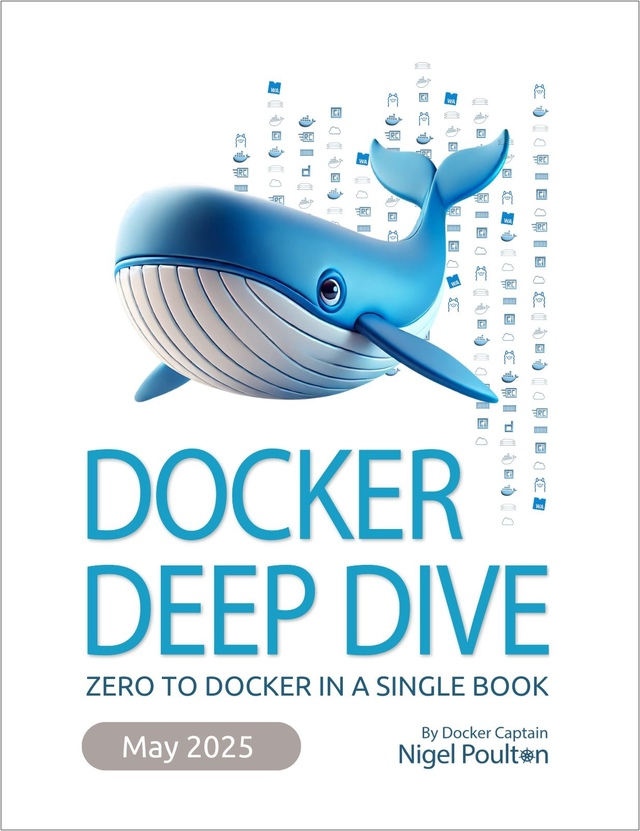

# Docker

Repositorio para la asignatura de docker!!

# Servicios del Proyecto

## [ExploraDocker]
* **Readme** [Enlace al readme que debemos conocer de docker.](exploradocker\README.md)

## [Apache]
* **Docker Compose:** [Enlace al fichero docker-compose.yml](apache\docker-compose.yml)

## [Duplicati]
* **Docker Compose:** [Enlace al fichero docker-compose.yml](duplicati\docker-compose.yml)

## [Excalidraw]
* **Docker Compose:** [Enlace al fichero docker-compose.yml](Excalidraw\docker-compose.yml)

## [ghost_protocol]
* **Docker Compose:** [Enlace al fichero docker-compose.yml](ghost_protocol\docker-compose.yml)

## [HelloDocker]
* **Docker Compose:** [Enlace al fichero docker-compose.yml](hellodocker\docker-compose.yml)

## [portainer]
* **Docker Compose:** [Enlace al fichero docker-compose.yml](portainer\docker-compose.yml)

## [snapdrop]
* **Docker Compose:** [Enlace al fichero docker-compose.yml](snapdrop\docker-compose.yml)

## [VSCode]
* **Docker Compose:** [Enlace al fichero docker-compose.yml](VSCode\docker-compose.yml)
